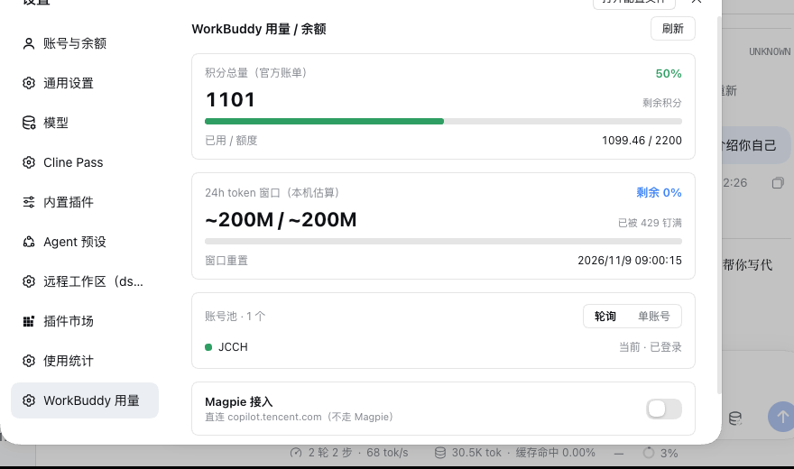
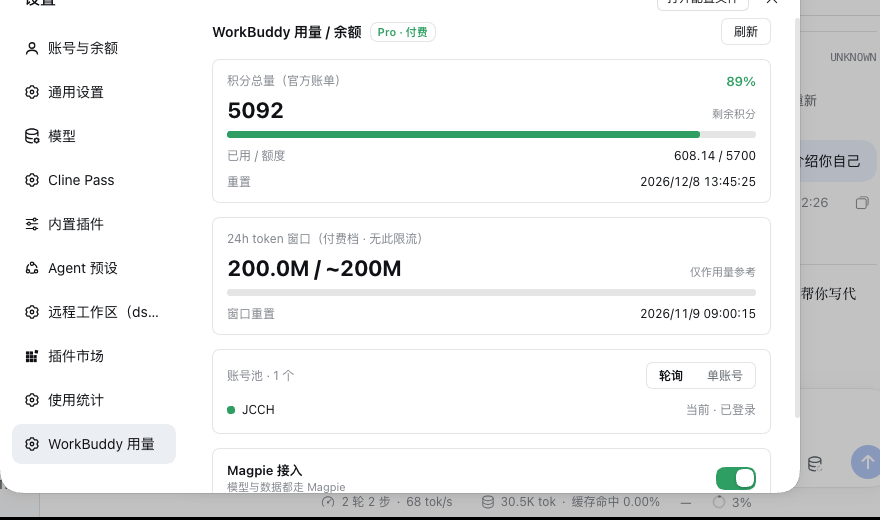
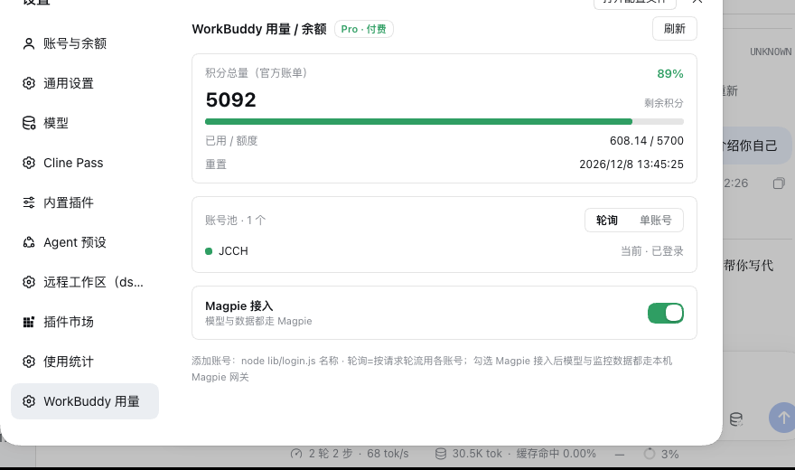
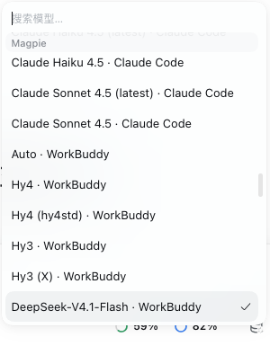
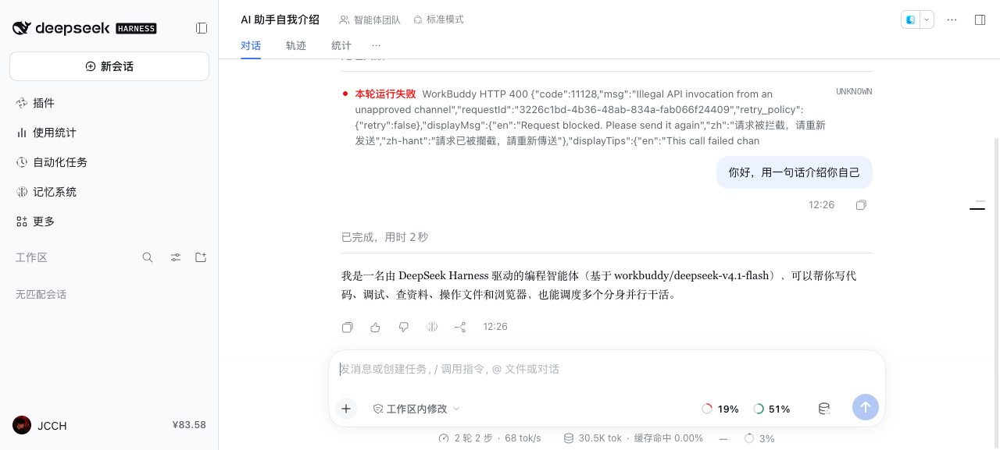

# workbuddy-monitor

> 实时监控 WorkBuddy 账号的积分用量与免费用户的 24h 窗口额度。
> Real-time monitoring of WorkBuddy credit usage and the free-tier 24-hour window quota, for DeepSeek Harness.

## 功能

- **积分用量**：直连 WorkBuddy 官方计费接口，官方口径、跨客户端一致（剩余 / 已用额度 / 重置时间）。
- **免费用户 24h 窗口额度**：免费档显示 24h token 窗口用量（本机估算；被限流时按官方 reset 时间钉满）；**付费档自动隐藏**该卡片。
- **免费 / 付费识别**：面板显示套餐徽章，据此决定是否显示窗口额度。
- **多账号**：多个账号自动轮流使用；面板内「＋ 添加账号」图形化登录。
- **每日自动签到**：自动领取每日签到积分，显示「今日已签到 / 连续 N 天 / +N 积分/天」。
- **Magpie 接入开关**：检测到本机 Magpie 才可用；开启后模型与监控数据都走本机 Magpie。
- **环境自检**：显示本机 DSH 与插件版本，并检查所依赖的宿主接口是否仍在；DSH 升级后未验证会给出提示。
- **可选：WorkBuddy 模型供应商**：把 WorkBuddy 作为 DSH 模型直连使用（`/v2/chat/completions`），不经 Magpie。

## 截图

### 设置面板（设置 → WorkBuddy 用量）

| 面板（卡片 + 滑动开关） | 付费档：套餐徽章 |
|---|---|
|  |  |

| 付费档：24h 卡片自动隐藏 |
|---|
|  |

### 设置导航图标


### 作为模型供应商（可选）

| 模型选择器里的 WorkBuddy 模型 | 直连对话 |
|---|---|
|  |  |

## 安装

```bash
dsh plugin add workbuddy-monitor
```

首次使用需登录 WorkBuddy 账号：打开 **设置 → WorkBuddy 用量**，点「＋ 添加账号」，按提示在浏览器完成登录（令牌保存在本机、自动刷新）。也可用命令行：

```bash
node <插件安装目录>/lib/login.js 账号备注名
```

## 数据来源与说明

- 积分与签到走 WorkBuddy 官方接口；24h 窗口在免费档为本机估算（跨设备会偏小），被限流时按官方 reset 钉满。
- 依赖 WorkBuddy 客户端接口，可能随官方版本变化；面板「环境自检」会在检测到不兼容时提示更新。
- 除「每日自动签到」（领取你自己账号的签到积分）外，本插件不修改账号状态。

## License

MIT
