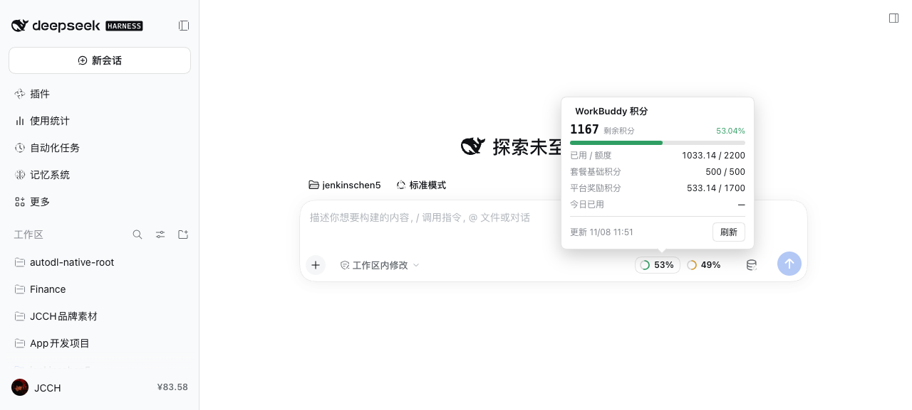
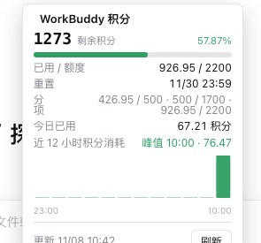
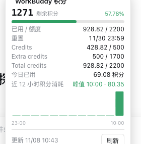
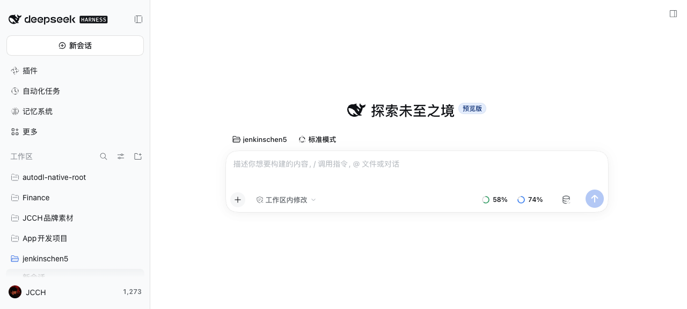
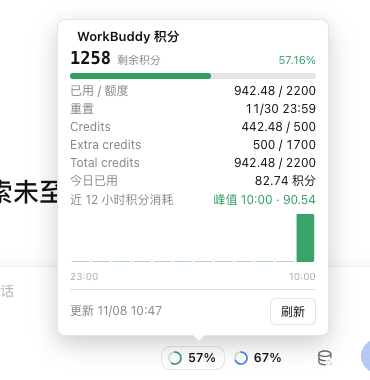
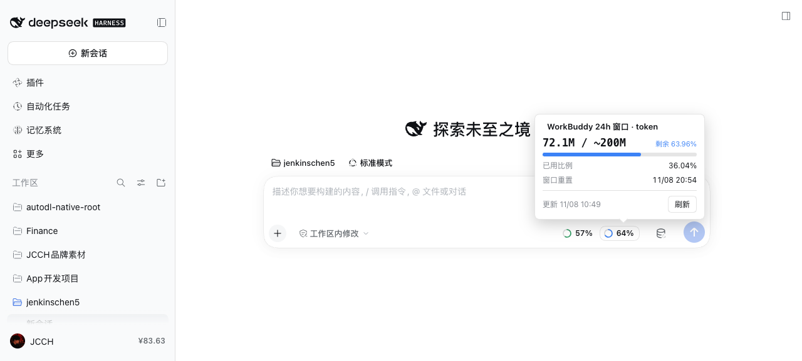
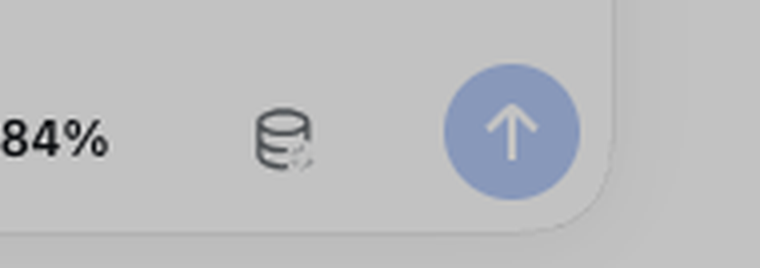
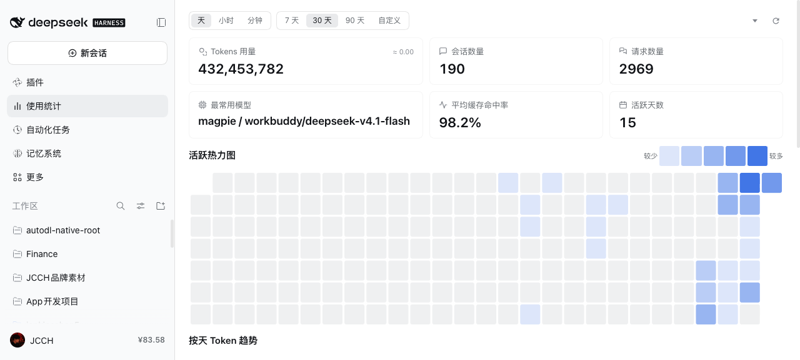
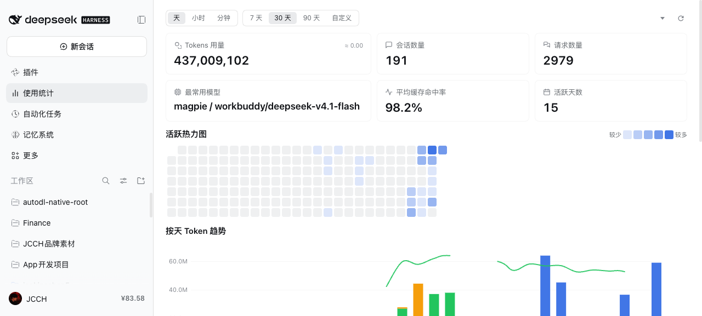

# workbuddy-monitor

**实时监控 WorkBuddy 账号的积分用量与免费用户的 24h 窗口额度**——输入框双环徽标 + 「设置 → WorkBuddy 用量」面板，支持多账号轮询、免费/付费自动识别、Magpie 接入开关。

> 附带能力：把 WorkBuddy 作为 DSH 模型供应商直连使用（可选，不经 Magpie）。

> 同仓另含配套的输入框徽标插件 `dsh-workbuddy-credits`（积分 / 24h token 双环徽标 + 悬停浮层）的截图。

---

## 截图总览

### 1. 输入框双环徽标（dsh-workbuddy-credits）

左「24h」、右「总积分」，颜色随剩余比例（绿 >50% / 黄 20–50% / 红 <20%）；只在 WorkBuddy 系列模型下显示。

| 直连模式 | 顺序（24h 左 / 积分 右） |
|---|---|
|  |  |

| 两枚徽标另一例 |
|---|
|  |

### 2. 悬停浮层（鼠标移上去在该徽标上方浮出，移开消失）

| 积分详情 | 分项分行 |
|---|---|
|  |  |

| 24h token 详情 | 居中 + 箭头指向徽标 |
|---|---|
|  |  |

| 修复「被槽位裁切」：portal 到 body |
|---|
|  |

### 3. 输入框模型图标（模型选择器收成一个图标）

| 收成图标 | 下拉列表名称完整 |
|---|---|
|  |  |

| 设置导航图标（用量表盘） |
|---|
|  |

### 4. WorkBuddy 直连供应商（本插件）

| 模型选择器里的 WorkBuddy 供应商与 17 个模型 | 新会话真实对话（直连成功） |
|---|---|
|  |  |

| 面板（卡片式新 UI + 滑动开关） | 付费档：显示套餐徽章 |
|---|---|
|  |  |

| 付费档：24h 卡自动隐藏 |
|---|
|  |

### 5. 用量统计插件（@mzzsfy/dsh-usage-dash，另装）

| 侧栏入口 | 面板（排版优化后） |
|---|---|
|  |  |

| 活跃热力图（格子 16px 固定、左对齐） |
|---|
|  |

---

## 功能

### 用量监控（核心）
- **积分用量**：直连 WorkBuddy 官方计费接口读取账号积分（剩余 / 已用额度 / 重置时间），官方口径、跨客户端一致。
- **免费用户 24h 窗口额度**：免费档实时监控 24h token 窗口用量（本机账本估算；被限流时按官方 reset 时间钉满）；**付费档自动隐藏该项**（官方已无此限制）。
- **免费 / 付费识别**：面板显示套餐徽章（`Pro · 付费` / `xxx · 免费`），据此决定是否显示窗口额度。
- **多账号**：账号池支持轮询 / 单账号，遇 401/402/429 自动换下一个账号；面板内「＋ 添加账号」图形化登录。
- **呈现**：输入框双环徽标（24h + 总积分，悬停出详情浮层）+ 设置页面板。

### 模型供应商（可选，附带）
- provider 名 `workbuddy`：`POST https://copilot.tencent.com/v2/chat/completions`（必须 `stream:true`，OpenAI `chat.completion.chunk` SSE），直连、不经 Magpie。
- 文本 + 工具调用；流式翻译成 DSH 的 `text-delta / reasoning-delta / tool-call-delta / usage / finish`。
- **请求格式兼容**：按 WorkBuddy 客户端的消息约定组织请求（system 开场统一、harness 指令放入 `<instructions>` 用户消息），确保在 DSH 中稳定调用。
- 模型：`deepseek-v4.1-flash`、`deepseek-v4-pro`、`glm-5.3(/flash/5.2)`、`kimi-k3(.1-pro)/k2.8-preview/k2.6`、`minimax-m3.1-flash`、`mimo-v2.6-pro`、`space-bunny`、`step-5-preview`、`hy3/hy3-x/hy4free/hy4std` 等（17 个 `/v2` 模型）。
- 令牌复用 `~/.config/dsh-workbuddy-credits/accounts.json`（由 `dsh-workbuddy-credits` 的 `node lib/login.js` 登录取得），自动 refresh。

### 账号池（仿 cline-pass）
- 账号存 `~/.config/dsh-workbuddy-credits/accounts.json`，模式 **轮询 / 单账号**（面板切换）。
- 遇 **401/402/429 自动换下一个账号**重试（流式仅在首字节前换号）。
- 加账号：`node lib/login.js 账号名`。

### 面板（设置 → WorkBuddy 用量）
- **积分总量（官方账单）**：剩余 / 已用额度 / 进度条 / 重置时间。
- **24h token 窗口**：本机估算；被 429 时按厂商 reset 钉满；**检测到付费档则整卡隐藏**。
- **套餐徽章**：自动识别免费/付费（`plan · 付费/免费`）。
- **Magpie 接入（滑动开关）**：检测到本机 Magpie 才可用；开启后**模型与数据都走 Magpie 网关**；未检测到则禁用并显示「安装 Magpie」按钮。

---

## 安装

```bash
# 依赖：dsh-workbuddy-credits（令牌 + 数据）
node ~/dsh-plugins/dsh-workbuddy-credits/lib/login.js   # 先登录一个 WorkBuddy 账号

# 以 link 方式装进 desktop profile
cd ~/.dsh/profiles/desktop
pnpm add "link:$HOME/dsh-plugins/workbuddy-monitor"
# 再把 "workbuddy-monitor" 追加到 package.json 的 dsh.profile.bundles
```

已打包：`dist/workbuddy-monitor-0.1.0.tgz`。

---

## 发布到 DSH 插件市场（注意事项）

要上架 DSH 插件市场，先决条件是**先发布到 npm**，而当前有两个硬门槛：

1. **npm 未登录**：本机 `npm whoami` 报 `ENEEDAUTH`。需先 `npm login`（交互式，账号/OTP 由你本人操作，我不会代填凭据）。
2. **包名已被占用**：`workbuddy-monitor` 已被 `0.0.1` 占用、`dsh-workbuddy-credits` 已被 `1.1.0` 占用 → 直接 `npm publish` 会 403。需改用**作用域名**或换名，例如：
   ```bash
   npm pkg set name=@<你的npm用户名>/workbuddy-monitor
   npm publish --access public
   ```
3. 发布后再到 DSH 市场（如 dshmarket / DSH Community Market）按其“提交来源/目录”流程登记该 npm 包。

> 这三步里第 1 步只能你本人做。完成后告诉我包名，我可以帮你把 `package.json`（name/repository/files 等）和 README 一起改成发布版，并核对可发布性。

---

## 说明 / 未包含
- 首版只做 `/v2` 模型；**Claude 系列（`/v1/messages`，Anthropic 协议）未包含**。
- 图片能力未做。
- 依赖 WorkBuddy 客户端接口与官方计费数据，可能随官方版本变化；仅供本机自用。
- 面板「24h token 窗口」在免费档为本机估算（跨设备会偏小）；付费档自动隐藏。
